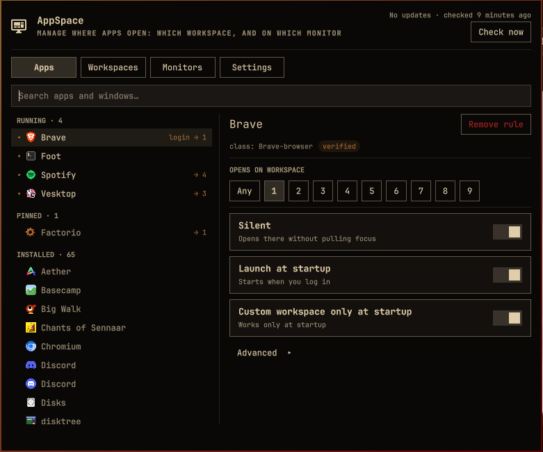
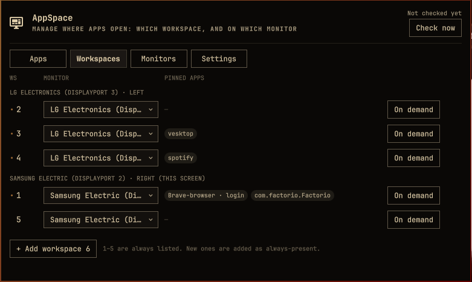
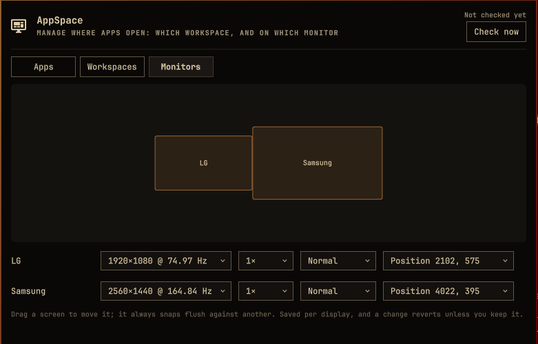

# AppSpace



An Omarchy bar widget that manages where apps open: which workspace, and on
which monitor, and how your monitors are laid out, without hand-editing the
Hyprland config.

Click the monitor icon on the bar. Pick an app on the left, click a workspace on the
right. The rule is written, Hyprland is reloaded, and if the app is already running
its window moves there immediately.

## Install

```sh
omarchy plugin add https://github.com/DominikZajac/omarchy-appspace.git --enable
```

That is all. Enabling puts the monitor icon in the bar's right section; move it
with `omarchy bar move dominikzajac.appspace --section center` if you prefer it
elsewhere.

**Upgrading from 0.3.0 or earlier:** the generated module moved out of `~/.config/hypr`.
Delete the `require("hypr.appspace")` line from `~/.config/hypr/hyprland.lua` and remove
`~/.config/hypr/appspace.lua`.

**Upgrading to 0.6.0:** nothing to migrate; your rules carry over. New: a **Monitors**
tab (layout, resolution, scale, rotation, placement by dragging) and, on Omarchy 4.5,
workspaces per monitor (see below). If you used hyprmoncfg only to arrange your
monitors, AppSpace can replace it: change one thing in AppSpace first so it saves your
current layout, then run `hyprmoncfg unmanage`.

### Uninstall

```sh
omarchy plugin remove dominikzajac.appspace
rm ~/.local/state/omarchy/toggles/hypr/appspace.lua
hyprctl reload
```

The rules file, `~/.local/state/omarchy/appspace/rules.json`, is left in place;
remove it too if you want nothing behind.

### Dependencies

Nothing beyond a stock Omarchy 4 install: `hyprctl` (reload, config check, moving
windows, listing monitors and their modes), `uwsm-app` (launch at startup, through Omarchy's `o.exec_on_start`),
`xdg-settings` (which browser web apps open in), `pgrep`, `git` and `timeout` (the
update check), and `sh`. The plugin
reads `/proc/*/environ` of your own processes to learn a running Steam game's app id,
and `/proc` again at login to measure how long Hyprland has been running.

### Updates

Omarchy checks itself for updates, but nothing checks plugins, so you could sit on an
old version without knowing. Twenty seconds after the shell starts, and then once a
day, AppSpace asks its own repository what its latest commit is
(`git ls-remote origin HEAD`). That is one small request to the repository you
installed it from. It fetches nothing and writes nothing, and like any request it
shows your IP address to the host.

The panel header shows the result, for example "No updates · checked 23 minutes ago",
with a **Check now** button. When a newer version exists it says so and the button
becomes **Update…**, which opens Omarchy's own updater in a terminal: it shows what
changes and asks before applying anything, then restarts the shell. AppSpace never
installs anything by itself.

To turn the daily check off, run `omarchy-shell dominikzajac.appspace updates off`.
*Check now* still works. A checkout that is ahead of its repository, such as a
development copy, is never reported as outdated.

After editing plugin code, run `omarchy restart shell`. Saving a file only
refreshes the plugin registry; a mounted widget keeps running the old code.

## Three views

**Apps** is every running window and every installed application, searchable, in
three sections: *Running*, *Pinned* (has a rule, not open) and *Installed*. Pick one
and set where it opens.

**Workspaces** is one row per workspace: which monitor it lives on, which apps are
pinned to it, and whether it is always present.



- `+ Add workspace` creates the next free one as always-present.
- Switch a workspace to *On demand* and it stays listed, so you can still pin apps
  or a monitor to it.
- Every workspace above 5 has a ×. Removing it drops its settings and the rules of
  the apps pinned to it, after a confirmation when apps or a monitor are attached.
  Open windows stay where they are.
- Monitors are shown by what you would call them: "Laptop screen",
  "LG Electronics (DisplayPort 2) · right". They are matched by `desc:` (make, model
  and serial), not by connector, so moving a cable to another port keeps the layout.

**Monitors** is the screen layout. See [Monitors](#monitors).

Switch views with the tabs or `Ctrl+Tab`.

## Omarchy 4.5: workspaces per monitor

Omarchy 4.5 gives every monitor its own workspaces 1-10. Hyprland still numbers them
globally underneath, in blocks of ten: the first monitor has 1-10, the next 11-20.
`Super+3` means "slot 3 on the monitor you are on". AppSpace follows this:

- **Rules and the Workspaces view speak in slots (1-10).** A slot assigned to a monitor
  means *that monitor's* slot; the generated Lua turns the pair into the real
  workspace id. A slot assigned to no monitor uses the first monitor's block. The
  Workspaces view lists each monitor's own slots under its name, and a slot can have
  only one owner.
- **Keys follow the assignment.** For every slot assigned to a monitor, `Super+N`,
  `Super+Shift+N` and `Super+Shift+Alt+N` go to the monitor that owns it, from any
  monitor. With slots 1 and 5 on one screen and 2-4 on the other, `Super+2` always
  lands on the second. Slots with no owner keep Omarchy's own behaviour.
- **Each monitor starts on the lowest slot it owns.** Omarchy would start it on slot 1
  of its own block, which may belong to another screen, so a window dropped there would
  sit on a workspace nothing lists. With slots 2-4 assigned to a monitor, it starts on 2.
- **A workspace strip in the bar.** `omarchy-shell dominikzajac.appspace strip on`
  shows, inside the AppSpace widget, the slots the bar's own monitor owns (its first
  five when it owns none). Clicking the focused one cycles its layout. Turn Omarchy's
  own workspaces widget off with `omarchy plugin disable omarchy.workspaces`, or you
  get two. The numbers appear where the AppSpace widget is; move it with
  `omarchy bar move dominikzajac.appspace --section left`.
- **Global plans.** On an Omarchy older than 4.5, or when another tool plans workspaces
  globally and switches Omarchy's per-monitor handling off (hyprmoncfg does, with
  `o.workspaces.enabled = false` in its generated file), AppSpace falls back to plain
  workspace numbers and writes monitor pins as workspace rules, as before.

## Monitors

The third tab lays out your screens. A map shows each one at its position and size.



- **Drag a screen** to move it. It always snaps flush against a side of another
  screen, sharing part of that edge, and snaps to the other screen's start, end or
  middle when close. A spot on top of another screen is refused. Screens cannot be
  left apart: the cursor could not cross the gap.
- **Per screen:** resolution and refresh rate (largest first, from the modes the
  screen offers), scale, rotation, and a placement dropdown ("Right of Samsung",
  "Above LG").
- **Keep or revert.** Every change keeps the previous layout for 15 seconds and undoes
  itself unless you press **Keep**, so a layout that blanks the screen fixes itself.
  Further changes inside that window revert to the layout from before the first.
- **Saved per display** by make, model and serial (`desc:`), as `hl.monitor` rules in
  the same generated module, so a layout comes back whenever that monitor does, whatever
  port it is on. The first change saves every connected screen, so the others keep the
  position they have.
- **Omarchy's scale shortcut** (`Super+/`) and its monitor panel write the new scale into
  `~/.config/hypr/monitors.lua`. AppSpace sees that and takes the scale over as the
  saved one, so the two do not fight.

Not included: named profiles and automatic switching between them (rules saved per
display already cover plugging a screen in and out), VRR, bit depth and HDR settings,
and turning a screen off from the panel.

## Where an app opens, and starting it at login

Each app has these independent settings, so you can mix them freely:

- **Opens on workspace**: pick a number, or **Any** (the default) to leave the app
  unplaced. With a number it opens there every time.
- **Silent**: the app opens without taking focus. It works with or without a
  workspace: placed, it opens on its workspace in the background; unplaced, it opens
  where it normally would but does not steal focus.
- **Launch at startup**: start the app when you log in. It does not need a
  workspace: launch it unplaced, or combine it with either setting above.
- **Custom workspace only at startup**: turns the chosen workspace into a one-time
  placement. Windows the app opens in the first seconds after you log in go there,
  and everything afterwards opens wherever you put it. This is what you want for a
  browser you start on workspace 3 at login but use anywhere later. *Advanced* sets
  how many seconds count (default 20). Measured at login with ten apps starting at
  once, Steam's first window took up to 38 s and Discord's up to 22 s, so raise it for
  an app that is slower than 20 s.

### How the startup settings work

- **Launching.** The generated Lua hooks Hyprland's `hyprland.start` event through
  `o.exec_on_start`; a config reload does not re-fire it, so reloading never relaunches
  your apps. The launch target is the Desktop Entry ID rather than a resolved command
  line, because `uwsm-app` resolves entries itself and gets the `.desktop` field codes
  right. An app with no desktop entry has nothing to launch, so the toggle stays
  inert for it.
- **Apps that start themselves.** Some apps start at login through an XDG autostart
  entry (1Password writes one when its "start at login" setting is on). Launching such
  an app a second time only loses a race and closes on its single-instance lock, so
  the plugin scans `/etc/xdg/autostart` and `~/.config/autostart`. For an app that
  starts itself the toggle says so and stays off, and its generated launch line waits
  two seconds for the autostart pass and launches only if the app's process is not
  already running. The app's own entry wins; AppSpace fills in only when it is absent.
  Apps that do not start themselves are launched directly. Apps hidden with a
  `Hidden=true` desktop-entry stub are not offered at all, since launching one fails.
- **Placing at startup.** A `window.open` handler moves every window of the app opened
  within the chosen seconds of the compositor starting. There is no window count, on
  purpose: a config reload during login would reset it. The seconds are measured from
  when the compositor process started (read from `/proc`), not from when the config
  was loaded, so changing a setting later in the session never makes the next window
  jump. The class is compared without regard to case.

## Which apps work

Tested on Omarchy 4.5 with Hyprland 0.56. "Out of the box" means a rule made from the
installed-apps row fires on the first launch.

| Kind | Examples | Out of the box? |
|---|---|---|
| Native app with a correct `StartupWMClass` | Alacritty, foot, Spotify, Signal, 1Password | yes |
| No `StartupWMClass`, the desktop id is the class | Nautilus, Evince, mpv, Chromium | yes |
| `StartupWMClass` with the wrong case | Brave (`brave-browser` → `Brave-browser`), Typora | first launch misses; the rule is respelled when the window appears and fires from then on |
| Flatpak | Discord | yes, by Flatpak app id |
| Omarchy TUI launchers (`xdg-terminal-exec --app-id=…`, `omarchy-launch-tui`) | Docker (lazydocker), Disk Usage | yes; every `TUI.tile` launcher shares one class and moves as a group |
| `Terminal=true` entries that open in the default terminal | btop, nvim | not listed: the window carries the terminal's class |
| Omarchy web apps | ChatGPT, GitHub, Basecamp | yes while the default browser runs on Wayland. With `--ozone-platform=x11` in the browser's flags file every web app is `Brave-browser`, indistinguishable from the browser |
| Steam, Proton / XWayland | Balatro, Dark Souls | yes, as `steam_app_<id>` |
| Steam, native Linux | Factorio | first launch misses; the real class is learned while the game runs and the rule moves to it |
| Wrong `StartupWMClass` | Obsidian, Pinta | launch it once, then assign from the running row; the stale guessed row keeps its rule until you remove it |
| No desktop entry at all | | from the running window only |

## How classes are found

`~/.local/state/omarchy/appspace/rules.json` is the single source of truth. From it
the plugin generates `~/.local/state/omarchy/toggles/hypr/appspace.lua`, which is
overwritten in full; never edit that file by hand. Omarchy loads every module in that
directory on each config reload, so nothing in `~/.config/hypr` changes. The plugin
never reads the Lua back.

Window classes come from `Hyprland.toplevels`, i.e. from live windows. That is
deliberate: a `.desktop` file is only a hint. For an app that is not running, the
class is derived from its desktop entry, in this order:

1. `StartupWMClass`, when it looks like a class. Arch's `chromium.desktop` declares the
   unfilled build template `@@startup_wm_class`; anything with template markers,
   whitespace or shell characters is ignored. Flatpak exports are skipped too: their
   declaration is copied from upstream while the sandboxed window carries the Flatpak
   app id.
2. Steam: `steam://rungameid/<id>` becomes `steam_app_<id>`.
3. Terminal launchers: the `--app-id=` on the command line (`TUI.tile`, `TUI.float`),
   or `org.omarchy.<name>` for `omarchy-launch-tui`.
4. Omarchy web apps: `omarchy-launch-webapp <url>` opens the URL in the default
   browser's `--app` mode, which names the window `<browser>-<host>_<path>-Default`,
   e.g. `brave-chatgpt.com__-Default`. The browser prefix follows the default browser
   the same way `omarchy-launch-webapp` picks it.
5. Otherwise the desktop entry id: `org.gnome.Nautilus.desktop` → `org.gnome.Nautilus`.

Rows are merged case-insensitively, and a live window's spelling always wins, because
that is the string Hyprland compares against. A rule written with a desktop entry's
spelling (`brave-browser`) is rewritten to the window's (`Brave-browser`) the first
time that window is seen, and the Lua regenerated.

Every derived class is labelled **guessed class** until a real window confirms it. A
declared `StartupWMClass` is a guess like any other: Obsidian once declared
`md.Obsidian` and opened as `md.obsidian.Obsidian`, Pinta declares `Pinta` and opens as
`com.github.PintaProject.Pinta`. **verified** means a live window has used the class.
Confirmation is sticky: once a window has proved a class, the rule stays verified after
the app closes, and a rule whose class no window ever used is called out as one that
can never fire.

Windows are watched while the panel is closed too, so a rule is confirmed, respelled or
carried over to an alias as soon as its window appears, not the next time the panel
happens to be open.

Steam needs special care. It writes one `.desktop` per game with no `StartupWMClass` and
a launcher `Exec`, so the plugin reads the game id out of `steam://rungameid/<id>` and
guesses `steam_app_<id>`: right for Proton and other XWayland games, wrong for native
Wayland ones (Factorio actually opens as `com.factorio.Factorio`). While a game runs,
the plugin reads `SteamAppId` from the process environment, learns which class the
launcher entry really opens, records that alias, and moves the rule over to the real
class. The launcher entry and the real window collapse into one row from then on.

## Keyboard

| Key | |
|---|---|
| type | filter the app list |
| `↑` `↓` | move through the list |
| `Tab` / `Shift+Tab` | walk the controls: tabs, workspace chips, monitor dropdowns, buttons |
| `←` `→` | move inside a chip group |
| `Enter` / `Space` | activate the focused control |
| `Ctrl+Tab` | switch between Apps and Workspaces |
| `Esc` | clear the filter, then close |

## From the CLI

```sh
omarchy-shell dominikzajac.appspace list
omarchy-shell dominikzajac.appspace set vesktop 3 normal     # third argument: normal | silent
omarchy-shell dominikzajac.appspace set vesktop any normal   # not placed (keeps launch at login)
omarchy-shell dominikzajac.appspace startup vesktop on 20    # place it only within 20 s of login; "-" keeps the seconds
omarchy-shell dominikzajac.appspace unset spotify
omarchy-shell dominikzajac.appspace pin 3 "LG Electronics MP59G 0x01010101"
omarchy-shell dominikzajac.appspace pin 3 ""                 # back to auto
omarchy-shell dominikzajac.appspace persist 6 on             # always-present workspace
omarchy-shell dominikzajac.appspace forget 6                 # drop workspace 6 and its pinned apps' rules
omarchy-shell dominikzajac.appspace autostart spotify on     # launch at login; no workspace needed
omarchy-shell dominikzajac.appspace updates off              # on | off | check | update
omarchy-shell dominikzajac.appspace view workspaces          # apps | workspaces | monitors
omarchy-shell dominikzajac.appspace select vesktop
omarchy-shell dominikzajac.appspace strip on                 # workspace strip in the bar; on | off
omarchy-shell dominikzajac.appspace monitors                 # layout as saved
omarchy-shell dominikzajac.appspace monitor "LG Electronics MP59G 0x01010101" 1920x1080@74.97 2102 575 1 0
                                                             # description, mode, x, y, scale, rotation (0-3)
omarchy-shell dominikzajac.appspace keep                     # keep a monitor change; revert undoes it
```

IPC arguments are positional and all of them are required.

## Write safety

Before writing, the plugin records `hyprctl configerrors` as a baseline. After writing
and reloading it checks again, and reverts **both** files if a new error appeared.

The baseline comparison matters: `configerrors` reports errors from the entire config,
so without it one unrelated broken file would roll back every valid change. Reverting
both files matters too: restoring only the Lua would leave `rules.json` claiming a rule
Hyprland has never seen.

## Limitations

- A rule applies every time a window opens, unless *Custom workspace only at startup*
  is on.
- *Custom workspace only at startup* places every window the app opens in its first
  seconds, so a second window you open by hand just after login goes there too.
- Matching is by window class only. Apps that open several windows under one class
  (Steam: library, friends list, update popups) are moved as a group. Narrowing by
  window title still needs a hand-written rule.
- Native Steam games get their real class only once they run: assign the launcher
  entry, start the game once, and the rule follows.
- A TUI that opens in the default terminal (`Terminal=true` with no `--app-id`) has the
  terminal's class and is not listed.
- Web apps can only be told apart from the browser when the browser runs on Wayland.
- The workspace list is 1-5 always, plus any live workspace up to 10, plus anything this
  plugin has a rule for.
- Workspace ids are worked out when the config loads, from the block file Omarchy keeps
  in `~/.local/state/omarchy/monitor-workspaces`. A monitor Omarchy has never seen has no
  block yet, so on a fresh install the first session uses plain slot numbers until the
  next config reload (any change made in AppSpace triggers one). Plugging a monitor in or
  out without a reload can likewise leave a rule on the old id until the next reload.
- Dragging in the Monitors tab only moves whole screens; rotating a screen changes its
  size in the map, and the neighbours are not moved to make room.
- `Silent` only governs where a *new* window is placed. Omarchy ships
  `focus_on_activate = true`, so an app that asks for attention later can still pull you
  to its workspace. Discord does this once it has finished loading. If an app does it
  and you do not want it to, add a rule for that app yourself in
  `~/.config/hypr/hyprland.lua`, which is what Omarchy does for Telegram:
  `o.window("com.discordapp.Discord", { focus_on_activate = false })`. It is left out of
  AppSpace on purpose: it would also stop a link you click from bringing that app
  forward, and no delay that works on one machine works on all of them.

## Files

| | |
|---|---|
| `manifest.json` | plugin manifest |
| `Panel.qml` | bar widget, the three views, write pipeline |
| `Rules.js` | model, JSON ↔ Lua serialization; no QML, no filesystem |
| `update-check.sh` | read-only update check, and the wrapper that runs Omarchy's updater |
| `tests/model.test.js` | model and generated-Lua tests |
| `tests/lua.test.js` | runs the generated Lua against a mocked Hyprland, in each workspace mode (needs `lua`) |
| `~/.local/state/omarchy/appspace/rules.json` | source of truth (schema 6) |
| `~/.local/state/omarchy/toggles/hypr/appspace.lua` | generated, overwritten in full, auto-loaded by Omarchy |

Run the tests with `node --test tests/*.test.js`.

## License

MIT
